# SPREE|FALL

An open world first person shooter set in a real reconstruction of central
Berlin, running from a single link in a browser. You spawn on Pariser Platz
facing the Brandenburg Gate, and you can walk east down Unter den Linden to
Museum Island and the Fernsehturm, south to the Holocaust Memorial and Potsdamer
Platz, and north to the Reichstag and the Spree. Reconnaissance drones hunt the
same streets, and every shot is traced through the real geometry of the city, so
a column of the Gate stops a bullet exactly where the column stands.

Every building, street, path, tree, river and rail line is generated from
OpenStreetMap data by a pipeline in this repository. The renderer, the physics,
the sound and the data pipeline are all written from scratch.

**No game engine. No 3D library. No runtime dependency of any kind.**

| | |
|---|---|
| Rendering | raw WebGL2, own shaders, own matrix maths, own scene graph |
| Physics | own capsule character controller against a 2D segment world |
| Combat | own hitscan raycasting against the same world, own flight AI |
| Audio | raw Web Audio API, every sound synthesised at run time |
| Map data | OpenStreetMap, parsed and triangulated by our own code |
| Shipped as | one HTML file, JS modules, one bundle per district, no backend |
| Extent | Berlin, out to the city boundary, 1,718 km2 in 81 districts, one in memory at a time |
| Payload | the code, the index and the district you are standing in: 4.69 MB over the wire for the city built here, 8.89 MB for the heaviest district of the real one |
| Difficulty | easy, normal and hard, with shields that come back |
| Third party code at run time | none |

## Try it

```
npm install          # only Playwright, and only for the tests and screenshots
npm run fetch        # download the OSM extract for the box, cached in data/raw/
npm run world        # build public/world.bin and public/world.json
npm run serve        # http://localhost:8080/
```

`npm run test` runs the pipeline unit tests, `npm run verify` takes the fixed
screenshots in a headless browser and fails on any console error, `npm run
test:ui` drives the whole game layer through a real browser, `npm run
test:combat` fights drones in one and checks the damage, the cover and the
memorial's force field, and `npm run clip` records the walk. `npm run build` writes a `dist/` folder that can be copied onto GitHub Pages,
Cloudflare Pages, or any static host. There is nothing to run on the server.

### All of Berlin at full detail, on your own machine

The deployed city has the detail of Mitte only in the middle, because GitHub
Pages will not publish a site over a gigabyte. On a machine of your own every
district can be built at tier 0, with the block tier for the fast travel
flight to pass over:

```
npm run world:full   # fetch every district with the full set of tags, then build
npm run serve
```

| | |
|---|---|
| Fetch | two hours or so, nearly all of it waiting on Overpass; districts bigger than three kilometres a side are asked for in pieces |
| Build | about half an hour; the biggest district needs about 3.5 GB of memory |
| Disk | five to eight gigabytes in `public/` |
| Browser | a desktop with its own graphics card; the game holds three of the biggest district at once, up to 1.5 GB |

The deploy builds the standard city and then moves districts up to tier 0 from
the middle outward for as long as the site stays under 950 MB
(`tools/fit-pages.mjs`). `--profile=` on `tools/fetch-osm.mjs` and
`tools/build-world.mjs` picks the city; `--tier=` and `--over=` set one
district by hand. A comparison of the same street at either tier is in
`docs/screenshots/tier-01-standard.png` and `tier-02-full.png`.

## Controls

| | |
|---|---|
| W A S D, arrow keys | walk |
| Shift | run |
| Space | jump onto kerbs and low walls |
| Mouse | look, with pointer lock |
| Touch | drag left to walk, drag right to look |
| Gamepad | left stick walks, right stick looks, A jumps, L3 runs |
| P | photo mode: hides the interface, unlocks the clock, saves a PNG |
| M | enlarge the map, on the streets around you |
| N | sound on and off |
| H | help |
| 1 to 6, or the mouse wheel | M16, shotgun, rocket launcher, grenade, C4, banana |
| 7 8 9 0 | railgun, plasma rifle, flak cannon, splinter gun |
| Z | flamethrower, right mouse throws a wall of fire that runs across the ground |
| B | incendiary bomb |
| X | EMP, which stops the machines where they stand |
| E, or right Shift | reflexes: the city slows and you do not |
| Space while reflexes run | a leap, paid for out of the same meter |
| F5 F6 F7 | difficulty: easy, normal, hard |
| C | the cheat menu |
| F | get into the nearest vehicle, or out of the one you are in |
| driving | W forward, S back, A D steer, Shift brake, left mouse fires |
| flying | it flies where you look; W S throttle (a fighter holds it), A D turn, Space climbs, right mouse drops |
| F4 | debug overlay |
| V | free travel: pick a place on the map and fly there |
| Q | back to the weapon you had before |
| T | blow the C4 you have put down |
| Left mouse, or RT on a pad | fire |
| Right mouse, or LT on a pad | aim down the sight |
| R | reload |
| G | holster the weapon, for walking and for photographs |

| `spreefall.debugMode(n)` in the console | 1 material, 2 normals, 3 uv, 4 world position, 5 material id, 6 detail fade, 7 view distance |
| F1 F2 F3 | quality tier: low, medium, high |

Getting within 40 m of one of the eleven landmarks slides in a card with its
name and a sentence of history. Find all eleven and you get a completion screen
with the time taken and the distance walked. The URL always carries your
position, heading and time of day, so a link opens exactly the view you were
looking at.

## Staying alive

**Shields first.** A layer over your health that takes the hit, comes back on
its own after a few seconds out of the fire, and breaks with a sound you will
learn to dread. The shot that empties it spends only what the shield had left,
so the break is a warning rather than a wound, and you get the moment after it
to find a wall.

**Three difficulties, chosen on the title screen or with F5, F6 and F7.** They
change the size of the shield, how long the quiet has to be before it comes
back, how hard everything out there hits, and how straight it shoots. On easy
your health comes back too, which is most of what makes it easy.

**Reflexes, on E.** The city drops to a third of speed and you do not: your
aim, your trigger and your feet all stay on the real clock, so a magazine goes
three times as far and a burst that was going to hit you is something you can
walk out of. The meter drains while it is on and fills when it is not.
Jumping while it runs spends a slice of it and throws you most of a storey up.

**Things lying in the street.** Thirty odd pads scattered over walkable
ground, found by asking the world where a person could actually stand rather
than by anyone authoring a list of coordinates. Run over one and it is yours;
it comes back on a timer, so the map is something you learn to move around.

The enlarged map opens on seven hundred metres of city around you rather than
on all forty six kilometres of it, and at that range it writes the street
names along the streets, from the `name` on the way in OpenStreetMap. A name
goes on every two hundred and forty metres of road and only if nothing has
already been written where it would go, with the main roads offered their
places first, which is how a paper map does it too. The wheel takes it out to
the whole city and in to a hundred and forty metres across; the names fade out
on the way out, at about a metre to the pixel.
Ammunition fills the weapon in your hands and tops up the rest of the loadout.
A medical kit puts fifty five back. Then the three that have a clock on them
and a chip on the interface counting it down:

| | |
|---|---|
| Quad damage | everything you fire hits four times as hard, for 22 s |
| Ultrashield | an overshield well above your normal maximum, for 26 s, then it bleeds back down rather than vanishing |
| Overload | you fire almost twice as fast and reload in under half the time, for 18 s |

The map marks every pad that is up, in the colour it glows in on the street.

## The shooter

**The targets are drones, not people.** This is a reconstruction of a real city,
with the Reichstag, the Cathedral and the Memorial to the Murdered Jews of Europe
standing where they really stand. Human targets in it would be grotesque. Flying
ones are also the more interesting problem: a quadrotor moves in three dimensions,
has to find its way around buildings it can see, and has to lose you when you
break line of sight.

**The memorial is under a force field.** It used to be a weapons free zone; now
the fight can go anywhere, and within 100 m of the middle of Peter Eisenman's
field nothing can be damaged. A blast there or one that reaches into it brings
no stele down, digs no crater, sets no tree alight and leaves no scorch mark,
while the street outside the circle comes down as it would anywhere else. The
field is a low dome of hexagons, faint until something lands on it and then lit
from the point of the hit outward. It is enforced in the shader, the baked
ruins, the collision and the ground alike, and the combat test checks each.

What is under the hood:

- Shots are hitscan through the real world. `World.raycast` walks a DDA across
  the 100 m tile grid, tests the collision segments as vertical quads and then
  marches the ground height field, at about 4.3 microseconds a ray. The world is
  tested first and the drones only within that distance, so cover is not a
  special case, it is the same geometry you are standing on.
- Ten things to carry, on the number row or the mouse wheel: an M16, a pump
  shotgun that throws eleven pellets, a rocket launcher, grenades, C4 you place
  and blow with T, a banana, a railgun that goes through everyone in the line, a
  plasma rifle whose bolts bounce round a corner, a flak cannon that fills a
  doorway with shrapnel, and a splinter gun whose darts chase. The last four are
  the arena tradition, which the deathmatch shooters of the nineties built;
  the names and the numbers are ours. Each one is a row in
  `src/game/arsenal.js`, because every difference between a rifle and a shotgun
  that the game cares about is a number.
- And on the wheel, past those, a void cannon: a slow green ball that reaches
  out to everybody within sixteen metres of where it is going, sends a tendril
  to everybody within forty eight of where it lands, and cuts a hole eighteen
  metres across into the frontage it hits. The joke is the oldest one in the
  arena shooters; the name is ours.
- Hold the sight on something with the launcher and it locks, and the rocket
  chases what it locked rather than where you were pointing when you fired.
- Recoil kicks and comes back. The view carries the climb as an offset and gets
  it back as the spring settles, keeping only the small share each weapon is
  allowed to keep, so a burst walks instead of stranding your aim in the sky. A
  full magazine of the M16 peaks about five degrees up and leaves two behind.
- Grenades, rockets, C4 and bananas are real objects with gravity that bounce
  off the actual walls of actual buildings, because they collide against the
  same raycast the bullets use, and against whoever is standing in the way: the
  first version of the rocket flew through the man it was aimed at and went off
  on the wall behind him. A blast damages everything inside its radius that it
  can see, including you. C4 sticks where it lands and waits.
- Drones patrol, pursue, attack and evade. They steer with four horizontal probes
  and a ground clearance term, so they do not fly into walls, and they re-test
  line of sight every 0.22 s rather than every frame, on a rota, so the cost is
  spread across frames instead of spiking whenever the sky fills up.
- Fighter jets arrive at threat three. They do not hover: one comes in from
  half a kilometre out, aims at where you are going rather than where you are,
  fires on the pass, breaks off, and comes round again in a wide turn. You
  cannot chase it, only be ready for the next run. Every second pass it drops a
  missile that chases you slowly enough that moving is an answer.
- Soldiers walk the same streets. They advance, take an angle on you, fire in
  bursts and lose you when you break line of sight, testing that line of sight
  from their eyes to yours through the real geometry. And they slip on a banana, which lays them out for
  three and a half seconds.
- Holding ground raises the threat tier, which raises how many of them are in the
  air at once, from six to fourteen. Integrity regenerates after a pause, and
  going down clears the sky, drops the threat by a tier and puts you back on
  your feet where you fell.
- Buildings take damage in two stages. Every explosion marks the wall it went
  off against: soot spreading with a ragged edge, the render darkened and
  roughened, the specular killed, and the lit windows inside the mark blown
  out. Enough explosions in the same place and that part of the building comes
  down, which has its own section above. The sixteen most recent marks are kept
  and the oldest is overwritten, because a fragment shader that loops over an
  hour of accumulated damage is a fragment shader nobody can afford.
- The scene is drawn into a target that shrinks when frames get expensive and
  grows back when they are cheap, between roughly half and full resolution. It
  is driven by the wall clock between frames rather than by how long our own
  draw calls took to return, because a GPU signs for the work and finishes it
  later: fed the latter, a machine at four frames a second thinks it has
  headroom. The interface never scales.
- The pads are placed once, at load, from wherever you came into the city. A
  candidate has to be inside the world, out of the memorial, clear of anything
  within arm's reach in six directions, and 45 m from every other pad; ninety
  tries per pad and whatever sticks is the map. Each is drawn as one instanced
  mesh per kind, fourteen centimetres proud of the collision height because the
  street that is drawn is not the height field that is collided against, and
  only within 260 m, where the fog has them anyway.
- Every sound is synthesised: a noise burst through a swept bandpass for the shot,
  a rotor bed whose level and pitch follow the nearest drone, and two different
  confirms for a hull hit and a core hit.

## Cheats

Press **C**. Everything here is off by default except the two destruction
switches, which are the game as it ships, and all of it is remembered between
visits.

| | |
|---|---|
| All weapons | every magazine and every reserve in the loadout, full |
| Reload everything | tops up what you are carrying |
| Drop a nuke | opens a map of the city; click where you want it, then confirm |
| Ion cannon | three beams in a ring, then the middle one |
| Ultra plasma | as many plasma balls from orbit as you like, over a circle, from a side and at an angle you set |
| Soldiers, Drones, Jets | brings a section, a flight or a pair out around you |
| God mode | nothing hurts you, though you are still told which way it came from |
| Infinite ammunition | the magazine never reaches the bottom |
| Nuke rain | one falls somewhere in the city every few seconds |
| No drones | they stop coming, and whatever is up leaves |
| Cinematic warheads | the camera follows one down and circles the hole |
| Slow motion blasts | the world drops to a crawl for a few seconds after anything large |
| Buildings can be destroyed | on as the game ships; off leaves every frontage standing whatever lands on it |
| Ground can be cratered | on as the game ships; off keeps the street level under a warhead |
| Tear enemies apart | a killing hit takes them to pieces instead of laying them down |
| Ragdoll | they fall with the momentum of the shot rather than on a timer |
| Blood | hits spray |
| Ultra gore | the three above, considerably more of it |
| Ultra gore, and then some | the same again, set where the pools run out, and bodies thrown across the street |
| Overkill | every kill an execution: the skeleton out of the body, pieces raining down, a fountain, a word across the screen |
| Slow motion on the last kill | killing the last one standing within sixty five metres drops the world to a crawl |
| Show what a building has left | the damage on the frontage you are aiming at, and how much more it takes |

A run with any of them moved off what the game ships with is marked `cheated`
on the interface, and the end screen says so. Switching them back does not
clear the mark.

The two destruction switches are separate because the two halves of a blast
are separate: a warhead with the buildings switch off digs its crater in a
square where every frontage is still standing, and with the ground switch off
it brings the block down onto a street that stays level. Both are honoured by
the picture, by the collision and by the ruin that is written into the city
afterwards, so what you walk on is always what you can see.

What the six gore switches actually are:

- **Tearing apart** replaces the death animation with its absence. There is no
  body to fall, so the soldier leaves the fight at once and a dozen chunks
  arrive in their place. Each chunk is a rigid body with a spin, built from one
  mesh drawn instanced, with its size and what it is made of carried per
  instance; that is why twelve different looking pieces are still one draw
  call. They collide against the real walls while they are moving fast and
  against the ground height field once they are not, which is a deliberate
  trade: a raycast per chunk per frame with forty in the air is half a
  millisecond nobody here has.
- **Ragdoll** is a rigid body, not a jointed one, and the README says so rather
  than implying a solver that is not there. The whole figure takes the angular
  momentum of the shot, tumbles about its feet, leaves the ground, lands and
  slides to a stop. Which way it turns comes from where the hit landed relative
  to the way they were facing. It settles onto its back or its face, because
  those are the two stable ways to lie.
- **Blood** is dark and heavy and gone in half a second, with a mist that hangs
  for a moment. It is nearly black rather than bright red, because blood on a
  grey street at four in the afternoon is, and the bright version looks like
  paint.
- **Ultra gore** is a multiplier over the other three rather than a fourth
  effect, which is both what it means and the only way to make it feel like
  more rather than different.
- **Ultra gore, and then some** is that multiplier again, set at the ceiling
  of what there is to spend: a hundred and thirty drops a spray instead of
  seventy six, stains out to five metres, and a shot that throws a body
  across the street rather than onto its back. It is the one gore switch that
  does not tear anybody apart, and that is on purpose: coming apart is the
  absence of a death, so there would be no body left to throw. Turn the
  tearing switch on as well and you get both, with a hundred and twenty
  pieces on a single body.
- **Overkill** is the switch above it, which needed bigger pools first: two
  hundred and fifty six pieces, two thousand sparks. Every kill comes apart
  whatever else is on, the skeleton leaves the body the way the round was
  going, a second burst goes up and rains back down, a fountain stands where
  they were for nearly three seconds, the walls round them are sprayed, and
  the clock stops for half a second while a word is stamped across the
  screen, counting a run of kills inside three seconds.

And the last kill:

- **Slow motion on the last kill** waits until the one you just killed was
  the last one on his feet within sixty five metres, and then runs the world
  at a quarter speed for a little over two seconds. It fires on
  that kill and no other, because a flourish on every kill is not a flourish,
  it is a stutter, and there is five seconds between them. Your own machine
  does not count as company, and neither does a body still falling: a soldier
  with no health left is on his own time already. A fight going on two
  streets away is somebody else's.

And the warhead:

- It is dropped, not fired. You pick the target on a map of the whole city,
  with the blast radius drawn at its real size so you can see what is inside
  it before you commit. The wheel zooms and holds whatever is under the
  cursor, dragging moves the window, and the first click arms rather than
  fires: it tells you how far away it is and how many targets are inside the
  circle, and warns you when one of them is you. Enter releases it, Esc takes
  it back. It comes in from four hundred and thirty metres up and takes about
  three seconds, so you hear it coming and you can watch it arrive.
- The blast is a hundred and seventy metres and everything in it that the
  fireball can see takes four thousand damage falling off with distance,
  including you. The fireball is fifty five metres above the crater and that
  matters: a blast centred on the cobbles has line of sight to nothing at all,
  because the first thing the ray meets is the street it started on. A building
  between you and it is still a building.
- The sound is three things in sequence and arrives late, at a third of a
  kilometre a second: the crack, a sub tone falling for most of a second, and a
  roll of noise that takes eight seconds to go away. The roll is the part that
  sells the size.
- **A warhead can go anywhere, the memorial included, and the memorial's force
  field takes what lands on it.** The map draws the field. That nothing under it
  can be damaged is the one line in the project that no switch in this menu
  moves.

**Cinematic warheads.** With that switch on, releasing one hands the camera
over. It leaves you where you are standing, takes a station beside the fall
line a hundred and fifty metres to one side, and tracks the thing down; the
world starts near real time and eases to a fifth of it as the bomb comes in,
because holding a three second fall at a fifth of speed for all of it is
fifteen seconds of watching an object get smaller. When it goes off, the
camera circles the impact and climbs away from it, and the city comes back up
to speed underneath. Space gives you back the controls. The simulation runs
throughout: the drones are still flying and the buildings still come down,
you are simply not the one looking.

**The ion cannon.** Picked on the same map. Three columns of light come down
in a ring fifty eight metres across and walk round the target for eight
seconds, speeding up the whole time, and anything they pass over burns: a
soldier caught by one loses the cloth and the webbing and what is left
standing is a blackened skeleton with the embers still in it. Then the ring
stops, holds for a second, and the middle fires: two hundred and ten metres
of everything, which is bigger than a warhead and the largest thing in the
game. It goes through the same blast path as everything else, so the
buildings come down, the trees catch and the collision opens up the way they
would from a grenade.

**A mech's reactor.** Every mech carries a fusion reactor, and killing the
machine does not kill the reactor: it runs away for a few seconds, blue
sparks pouring out of the wreck and a chord rising under them, and then goes
up as a small atomic blast in electric blue and neon green, forty six metres
of it, which takes the street and any machine standing in it. Your own gives
you five seconds once you have been blown clear of it.

**Ultra plasma.** Picked on the same map, with four sliders beside it: how
many balls (the slider goes to three thousand and the box under it takes any
number), how wide the circle is, which side they come in from and how far
off the vertical. The circle and an arrow for the way in are drawn on the
map, the arrow the longer the flatter they come. After you fire the system
charges for four seconds, a chord climbing six times over with the tremolo
speeding up, and then the balls come down: the plasma rifle's bolt three
times across, cyan, with a streak behind it, at a hundred and twenty metres
a second, bouncing twice like the rifle's and going off on the third thing
they meet. They come thirty a second at first and a hundred and forty after
six seconds, and never more than four hundred and eighty in the air at
once; the rest wait their turn, so a hundred thousand costs nothing until
they are falling.

**Blast plasma.** A box under the sliders, and the same thing on the plasma
rifle: hold the second mouse button for ten seconds and the next bolt is the
hard kind. It does not bounce, it goes off on the first thing it touches and
it does ten times the harm, and it burns a very bright orange where the
ordinary bolt is cyan, so you can tell from the street which one is coming.
The charge shows under the crosshair and is lost if you let go early.

The skeleton is real geometry rather than a texture. The soldier mesh carries
a ribcage, a spine, a pelvis, a skull and limb bones inside the body, and the
vertex shader collapses one set of parts or the other to nothing depending on
how burnt they are, so a person and a skeleton are the same mesh and the same
draw call.

## Just a Walk

A third mode on the title screen, next to Berlin and Rise of the Machines.
Nothing is sent after you: no soldiers, no drones, no jets, no machines, and
the whole of the city to walk about in. The cheat menu still brings anything
out by hand, and what it brings out is a real enemy with a real fight in it;
it simply is not replaced when it goes down. The mode is remembered between
visits, because it is a choice about what you came for rather than a setting.

## The people who live here

In Just a Walk the streets have somebody on them. They are soldiers in the one
sense that matters to the engine, which is the walking, the ground under them,
the capsule you can hit and the single draw call; everything else about them is
about fifteen lines. They carry nothing, wear no helmet, have a coat in one of
four colours picked per person, and walk from somewhere to somewhere else. A
shot inside seventy metres, a blast, or anything arriving in a sphere of light
sends every one of them running straight away from it for seven seconds, and
then they go back about their business. They are not in the fight, nothing
counts them as a contact, and nobody is hunting them.

## How they arrive

Nobody walks round a corner into this fight. A sphere of light stands on the
street for a moment, a shell of it falling inwards rather than blowing out,
with arcs crawling up off the pavement and a scorch mark left under it, and
the soldier comes up through the street into it. For the second that takes he
is under the pavement, blind and harmless. A machine arrives the same way, in
a sphere the size of the thing inside it.

## Vehicles

Four of them stand near the spawn when the city loads, a fresh set is parked
around you each time you cross into a district, and the cheat menu will put
one wherever you are. On foot, standing next to one puts **F** and its name on
the screen; empty ones are squares on both maps. **F** gets you into the
nearest, and out of the one you are in. The camera goes to a chase view behind
it, because the inside of a tank is not a thing this project is going to
model, and the gun fires wherever you are looking.

Whatever you are in has a readout: what it is, what is left of its hull, how
fast it is going, whether the gun is ready, and in the air how far it is to
the ground. The bar goes amber under a third and red under a sixth, and one
line underneath says what is about to go wrong.

**W** is forward, **S** back, **A** and **D** steer, **Shift** brakes. When
you climb in, the view turns to face the way the hull is pointing, and while
you steer it turns with the hull, so forward is always into the screen. Before
that the camera kept the heading you had on foot, which meant a tank parked
across your line of sight drove off sideways or straight past you when you
pressed forward: the hull was going nose first the whole time, but what you
saw was a tank reversing.

| | |
|---|---|
| Jeep | 24 m/s, light, a mounted gun on the back |
| Tank | 12 m/s, two and a half thousand health, one shell every two and a half seconds |
| Helicopter | hovers; space climbs, right mouse holds the rockets |
| Fighter | 180 m/s, and it stops flying below 38 |

Both aircraft fly where you look. The mouse, or A and D, turn the view, and
the aircraft turns its nose onto it as fast as it can, banking into the turn
on its own; W and S are the throttle. A fighter turns harder the faster it is
going and only lifts its nose off the road once it has the speed to fly.

They divide into two kinds rather than four. Something with wheels follows
the ground, refuses a kerb taller than it can climb, leans into a slope, and
loses its steering as it speeds up, so a jeep at full throttle cannot turn on
the spot. Something with rotors or wings does not: the helicopter's thrust is
up out of its own rotor disc so pitching forward is what makes it go forward,
and the fighter's lift comes out of going fast, which is why below its stall
speed it falls instead. Everything else between the four of them is numbers
in one table.

Both kinds collide against the same world as everything else: the ground
height field under the wheels and the collision segments in front of the
bumper, from the same raycast the bullets use. They can be shot at, they
catch fire and they go up.

## Free travel

Press **V**, or the travel button. The same map comes up, you pick a place,
and the camera takes you there: straight up off the street until the district
is under you, across at two to four hundred metres where you can read the
streets going by, and down on the far side. The city stays live the whole way,
so the drones are still up and the rubble is still where it fell.

A cut would be cheaper and would throw away the one thing this project has,
which is a city laid out the way the real one is. Flying it means you arrive
knowing roughly where you are, which is what a map on its own never tells you.
Nothing is off limits: walking into the memorial has always been allowed, it
is firing there that is not.

## Destruction

Buildings come down, and the ground craters. This section used to say the
opposite, and the reasoning for that is still in `docs/PLAN.md`, because the
constraint that drove it has not changed: the city is baked into per tile
vertex buffers at build time, and nothing here rebuilds geometry in the middle
of a frame. What happens instead is that the vertex shader bends the city
around a short list of collapse sites.

- **A building comes apart in stages, from the top.** Damage accumulates on a
  22 m grid, about the width of one Berlin apartment block. Each step takes
  another quarter off: the shader cuts the building back to the share of its
  own height that is left, so at a quarter gone it is the top quarter that is
  missing and the storeys below it are still a building with windows in them.
  Five rockets into the same frontage take it from standing to a heap, one
  piece at a time, and each step throws its own rubble off the line it broke
  at and makes its own noise.
- **A collapse pulls what is above the cut down onto what is below it** and
  pushes it outward, with a per vertex scatter, so a facade folds into a heap
  rather than squashing flat. The normals go to vertical, the render goes to
  broken concrete and brick dust, and the lit windows go out, but only for the
  part that moved. The shadow pass runs the same displacement, or a flattened
  building would go on casting a standing shadow. A big collapse rolls
  outward from its middle rather than dropping flat.
- **The collision follows, partway through the fall rather than at the end**,
  so you are never stopped by a wall that is visibly no longer there. Walls
  are stored as one quad per building edge and an edge can be thirty metres
  long, so the first time a collapse touches a tile its long walls are cut
  into five metre pieces; otherwise a whole facade would open up or not
  depending on which side of the blast its midpoint happened to be. Each piece
  then loses its own height, measured from what it was before any of this
  started.
- **A warhead craters the ground, and the crater is nothing like the size of
  the blast.** A hundred and seventy metres of blast digs a hole thirty six
  metres across and eleven deep, with a ring of thrown up ground around the
  lip and flat street again well inside the collapse. The collision height
  field is dug with the same profile the vertex shader draws, so a crater you
  can see is a crater you can walk into. Small blasts do not crater at all:
  the ground mesh is a 12.5 m grid, so a hole eight metres across would have
  no vertices to move and would be an invisible trap in the collision.
- **The rubble has weight.** A lump of concrete lands once and stays where it
  fell; a lighter piece skips. Whatever is still sliding rolls as it goes, and
  the roll is what takes the last of the speed out of it. Pieces come off the
  line the building broke at rather than out of the ground, and they pile up
  towards the middle of a collapse rather than lying flat across it.
- **Sixteen sites at once.** A new collapse that overlaps an old one grows it
  rather than taking a slot, and when all sixteen are taken the nearest one
  swallows the new one. Nothing is ever evicted, because evicting a site would
  stand a flattened building back up. An undamaged city leaves the count at
  zero and the vertex shader skips the loop entirely, so nobody pays for this
  until they have knocked something down.
- The memorial does not come down, by the same rule as everything else.

## Trees burn

Anything that goes off sets light to the trees around it, over a radius
getting on for twice the blast, because fire spreads and a blast does not.
A tree that catches browns, then blackens, then either bursts or goes over,
and which of those it does is decided by the tree.

All three thousand seven hundred trees are drawn from one instanced call with
no mesh data and no per tree storage, so a fire cannot be a list of burning
trees in a buffer somewhere. It is a circle on the ground with an age: eight
of them, as eight vec4s. Every tree inside one runs the same timeline off its
own seed, so one goes up at three seconds and its neighbour stands for eight,
and the edge of a fire catches about two seconds after the middle. The crown
shrinks as the leaves go and glows at its edges while they are going, because
a burning canopy is lit from the inside and the outline is the part that
reads at a distance. A tree that topples rotates about its base in the
direction its own seed picked, accelerating, and the shadow goes over with
it.

The JavaScript side runs the same seed arithmetic, so the flames come off
real trunks and the crack of one going over happens on the tree that is going
over. The two sets of timings are written out twice and have to agree; that
is the price of not uploading anything.

## Fire you carry, and a wall of it

The flamethrower is on Z. The primary is a stream rather than a shot: a cone
two dozen metres long that drains fuel by the second instead of by the round,
sets light to whatever is in it and goes on burning it afterwards. The second
trigger throws a wall. It is a line of fire eleven metres across that leaves
you and runs away at a jogging pace, following the ground as it goes, up a
kerb and down into a crater, burning what it passes over and leaving the road
itself alight behind it for eleven seconds. The wall is not geometry: it emits
flame particles along its length, the same way every other fire here is drawn,
so it costs nothing on the card.

The incendiary bomb on B is the same idea thrown: a modest blast and then a
ring of burning pools, so a street is on fire for the next half minute rather
than for the frame of the explosion. The EMP on X is the opposite of all of
it, and it only matters in one mode.

## Rise of the Machines

A second way to play the same city, picked on the title screen along with the
time of day. The sky goes the colour of a dead screen, warheads come down
every two or three seconds somewhere on the skyline, and the things on the
street are steel skeletons with one red eye each, which hum while they look
for you and fire a beam when they find you. Nothing in it is a new enemy
type: a machine is a soldier with a different body, a different gun and no
skin, because the soldier already knows how to take cover behind a real wall
and how to lose you when you break line of sight, and that behaviour is the
expensive part. The EMP stops every machine inside thirty four metres for
seven and a half seconds and leaves it standing there taking quadruple damage,
which is the whole tactic: stop them, then take them apart.

It is a mode and not a cheat, so a run in it is not marked as cheated.

## Mechs

Eight metres of walking gun platform, theirs and yours. A mech is not a
vehicle: it walks, so it follows the ground and steps over kerbs, and its legs
turn slowly while its torso turns fast. The torso is where the guns are, so it
can walk one way and shoot another, and that split is most of what makes one
feel like forty tonnes rather than like a car.

**Yours** comes out of the cheat menu and you climb in with **F**, the same
key as everything else. W A S D walks it, the mouse aims the torso and the
legs chase the torso, the left mouse is a chaingun, the right mouse throws a
salvo of six rockets, **Shift** dashes and **Space** jumps. The landing is a
weapon in its own right: forty tonnes arriving opens the road and takes apart
whatever is standing in eleven metres of it. The camera hangs behind the
shoulders, because the thing worth looking at here is the mech.

**Theirs**, the Reaper, walks in from two hundred metres, closes to about
forty, sidesteps rather than standing still, and fires five rounds then waits
two seconds. Rockets only past fifty five metres. Rise of the Machines keeps
two of them on the streets; the cheat menu will drop a pair wherever you are.

There are ten of them, and the cheat menu has a row for yours and a row for
theirs. Yours is the one the next titanfall brings; theirs is the one that
comes for you, from the menu and in Rise of the Machines, and can be random,
a new throw for each one that arrives.

| | |
|---|---|
| Warden | the all rounder: chaingun, rocket pod, a dash and a shield |
| Bruin | heavy brawler: slow, broad, a shotgun fist and a big shield |
| Heron | tall marksman: long legs, a railgun on the shoulder, thin armour |
| Lynx | light raptor: reverse knees, very fast, a long dash, little armour |
| Bastion | walking fortress: shoulder shields, a cannon, the biggest shield |
| Hornet | missile boat: two racks of ten, jump jets that clear a roof |
| Colossus | eleven metres: slow as a tram, a landing that flattens a square |
| Mantis | four legged spider: low, wide, climbs what the others cannot |
| Ram | chicken walker: no arms, a head full of guns and a charge like a train |
| Wraith | faceted and dark: fast, a beam on the arm, a shield that comes back quickly |

Each carries its own weapons, and no two the same. Yours switches between
its arms with the number keys or the wheel; theirs fires its own gun and a
rocket pod:

| Chassis | yours carries | theirs fires |
|---|---|---|
| Warden | chaingun, 40 mm cannon, EMP bomb | a chaingun in bursts |
| Bruin | Leadwall, thermite launcher, car bomb | a shotgun |
| Heron | plasma railgun, power laser | a railgun, one bolt every three seconds |
| Lynx | chaingun, car bomb, Stinger | a fast chaingun, long bursts |
| Bastion | 40 mm cannon, 88 mm flak, EMP bomb | a cannon |
| Hornet | Stinger, 88 mm flak | a swarm of small rockets |
| Colossus | 88 mm flak, 40 mm cannon, thermite launcher | flak shells, four at a time |
| Mantis | thermite launcher, power laser, car bomb | thermite canisters |
| Ram | 40 mm cannon, Leadwall | twin shells |
| Wraith | power laser, plasma railgun, EMP bomb | a beam held on you |

Each one is a row of numbers in `src/game/chassis.js` (size, where its hips
are, speed, turn, armour, shield, jump, dash, the landing, where its guns
are and which arm weapon it arrives holding) and a shape in
`src/render/mechmeshes.js` built round the same numbers. Yours wears the
chassis' own colour and theirs all wear gunmetal with red trim, which is how
you tell them apart across a square whatever they are.

Each chassis is one mesh and one instanced draw call, and the walk, the torso
turn, the pitch, the stride bob and the fall are all in the vertex shader,
which splits the mesh at that chassis' hip line; the spider's legs go in
diagonal pairs, each about its own root.

## The city is eighty one districts

Mitte at full detail is 4.40 MB over the wire and 6.5 square kilometres;
Berlin out to the city boundary is 1,718 square kilometres of lattice, and at
Mitte's detail that would be hundreds of megabytes. So the city is cut into
districts, built one at a time, thinned with distance from the middle, and
exactly one of them is in memory while you play. What a player waits for is
one district, not the city.

**The box.** The playable area is the Land of Berlin: 52.3380 to 52.6760 N,
13.0880 to 13.7620 E, which is 45.7 km by 37.4 km. That extent is the one two
independent sources give, an OpenStreetMap talk-de posting and the EPSG
registry's area of use for EPSG:3068, the Berlin Soldner grid. The city proper
is about 891 of those square kilometres; the rest of the box is Brandenburg,
and the districts that fall entirely in it come out nearly empty, which costs
almost nothing and keeps the lattice regular. The Ringbahn box, from the four
stations at its corners, is still in the code: it is no longer the edge of the
world, it is the line the detail tiers are measured from.

**The cut.** One tile grid, 458 by 375 tiles of 100 m, covers the whole thing.
A district is a rectangle of that grid. The lattice is deliberately irregular:
near the middle a district is about one and a half kilometres across, because
that streams in quickly and the detail there is high; out past the ring they
are four kilometres and past that eight, because a district is one Overpass
query and one build and nobody wants four hundred of either. The cuts land on
grid lines, so the districts partition the city exactly and nothing overlaps: a
building belongs to the district its middle is in and is built once, and roads,
parks and water are clipped at the boundary so neither side draws the other's
half. Each district is fetched from Overpass with a margin around it, so a wall
standing on a boundary arrives whole in both.

**The tiers.** Detail falls off with distance from the middle.

| tier | where | districts | what it carries |
|---|---|---|---|
| full | Mitte | 1 | every building, landmark models, stelae, windows, 33 point height field |
| near | next door | 4 | buildings over 40 m2, simplified footprints, windows, 17 point field |
| block | out to the ring | 19 | buildings over 120 m2, flat roofs, no windows, driving roads only, 9 point field |
| outline | the rest of the city | 36 | buildings over 250 m2, 5 point field |
| sketch | the edge of the box | 21 | buildings over 600 m2, the shape of a place rather than a place |
| overflight | a second build of tiers 0 to 2 | 24 | buildings over 250 m2, all of them boxes, 200 m ground, for a fast travel flight to pass over |

**The streaming.** `World` holds an index of all eighty one and the bytes of
as many as fit: the one you are in, every one within nine hundred metres,
nothing past 2.6 km, and a ceiling of six districts and 128 MB. Tile records
carry their index in the global grid and a reference to the district buffer
their offsets point into, so the collision, the height field, the raycasts and
the renderer all carry on addressing the city by tile index and do not know
which file the bytes came from, or which of the two builds of that district it
is. Walking across a boundary is a step rather than a wait: the neighbour comes
down while you are still walking towards it, and the one behind you stays. The
loading screen is still there for arriving somewhere that is not in memory,
which is a fast travel or a link rather than a walk. The map is the whole city
whatever is loaded, drawn from the index, dim for the ones you do not have, and
you can zoom from a street out to all of Berlin and back.

**The flight.** Free travel crosses the city at four hundred metres a second,
which leaves a district a few seconds between coming into reach and going
past, and its own bundle does not arrive in that. So the streamer asks for the
overflight build instead, and looks up the line of the flight rather than in a
circle. The destination is the exception: it is fetched at the district's own
tier the moment you pick it, and the landing holds in the air until it is
there. The moment the flight ends, every district held at the overflight tier
is let go, so a walker can never reach one and no two districts you can walk
between are at different tiers.

**What it weighs.** All of Berlin at these tiers is 304 MB deployed and 107 MB
over the wire, measured on 13 October 2026 with every one of the eighty one
districts built from the live extract: 102,691 buildings over 1,717 square
kilometres, which is 0.062 MB of download per square kilometre. None of that
is what a player downloads. What comes down before you can walk is the code,
the index and the district you are standing in: 4.69 MB for the eight built
here, and 8.89 MB for the biggest district in the real city, with most at two
to five.

There was a hard ceiling on that number, 25 MB a district, carried over from
the brief. It is gone. It never bound anything, because the biggest district
is a third of it, and holding detail back against a figure that was never
reached is the wrong way round: the test is whether the thing is playable,
which is a wait you will sit through and a frame rate you can move in. A
ceiling is still there for anyone who wants one, and then it does fail the
build, because a limit nobody acts on is not a limit: `npm run fit -- --budget=12`.
`npm run fit -- --whole=25` still cuts the city down to what fits as a whole.
`npm run weigh` prints the table of districts, `npm run fit` prints what you
wait for, and `.github/workflows/city.yml` builds from the live extract and
publishes both.

## Two cities, and which one you are looking at

The sandbox this was built in denies every OpenStreetMap host, so the local
build runs on the offline fallback described below. The deploy has no such
limit: GitHub Actions fetches the live Overpass extract on every push, and the
site at the link above is built from it. They are not the same city.

| | offline fallback | deployed, live OSM |
|---|---|---|
| Source | 1.47 MB of generated OSM XML | 22.78 MB from overpass-api.de |
| Buildings | 1,672 | 3,354 |
| Street | 44.3 km | 364.1 km |
| Trees | 3,728 | 5,582 |
| Stelae | 2,711 | 2,711 |
| Triangles | 132,397 | 413,173 |
| Payload | 9.42 MB, 2.28 MB gzipped | 21.33 MB, 7.90 MB gzipped |

Everything this project knows about Berlin that OpenStreetMap does not is in
`tools/berlin-facts.mjs`: the surveyed footprints of the landmarks, the eleven
card texts, and the size and count of the stelae. `tools/annotate.mjs` attaches
those facts to whatever extract the build was handed, and it prefers the real
feature every time. On the live extract it finds 21 of the 23 landmarks already
mapped and gives them their proper shapes on their real footprints, adds the two
it cannot find, and hangs the stelae field on the memorial outline that OSM
already draws. Only where the data has nothing does a surveyed footprint get
used as it stands.

This matters more than it sounds. Every piece of curated content rides on those
facts, including the force field: the game finds the memorial through the
landmark card, so without this pass the deployed city would have no memorial,
no stelae and no field over them at all, which was exactly the state of it
until the build log was read.

## What is real and what is generated

This matters, so it is spelled out rather than glossed over.

**Relief on the frontages.** A cornice under the eaves on anything over nine
metres, and a band over the shop windows where the ground floor is a shop.
Both are bands rather than mouldings: two quads an edge, the face you see and
the underside the sun never reaches, and it is the second one that does the
work, because the shadow line under a projecting band is what makes a frontage
read as relief. Only in the middle, where you walk: it costs a quarter of the
triangles of that district and is only worth that from the pavement.

**A shell opens the wall it goes off against.** A hole is a `discard` inside
the same ragged noise edge the shader already drew the soot with, so the rim
and the scorching are the same shape and it reads as torn rather than cut. The
tiles round a blast are drawn a second time inside out, which is what fills
the hole with the inside of the building instead of the sky. Measured by
drawing the frame twice, once with the hole and once with the same scar at
nought: 2.31 m of hole and 40.5 per cent of the frame different between them.
Two limits worth knowing: the hole is in the picture only, so the collision
still has the wall whole and a shot through it stops, and it lives as long as
the sixteen most recent blast marks. What is permanent is the collapse.

**The city streams.** Walking into another district used to be a card and a
wait. The neighbour now comes down while you are still nine hundred metres
inside your own, and crossing is a step: three districts and 26 MB held
walking east out of Mitte, with the one behind you still there when you turn
round. The card is still there for arriving somewhere that is not in memory,
which is a fast travel or a link rather than a walk.

**Roofs everywhere, and they were cheaper than flat ones.** The ring and the
outskirts had flat roofs because the tier table said a pitched roof costs four
more vertices per metre of frontage. Measured, it is the reverse: a flat roof
here is a cap plus a parapet, and a parapet is two triangles for every edge of
a footprint. Turning the roofs on took the city from 875,427 triangles to
869,559 and from 15.88 MB to 15.85, and gave the ring a skyline of red tile,
slate and copper.

**Windows everywhere, not only in the middle.** The ring and the outskirts
used to be blank walls, because the tier they are built at had the window
shader switched off. It costs nothing: the flag is one bit on the vertex and
the pattern is a fragment shader reading the building's own storey count, so
the city is the same 875,427 triangles and the same 15.88 MB either way. What
had to come first was a fade: the facade is the one pattern in this renderer
made of hard edges rather than smoothsteps, so once a pixel covers a storey it
now draws the average of a frontage instead of a pattern nobody can resolve.

**The street you are standing in.** Named under the crosshair, faint while
you walk and up for four seconds when it changes. Measured to the road
centreline rather than to a map label, because a label is a point every two
hundred and forty metres and the nearest one is routinely on the next street
over; a junction is a tie and the tie goes to the wider road.

**Surfaces with real maps.** Ten tiling maps built when the page loads, out
of the same noise the shader used to run per pixel, handed to the card as one
array texture with a mip chain and anisotropy on it. They are not albedos: the
colour of a wall comes from the palette and the colour of a road comes from
the shader, so a map carries the slope, a multiplier on the albedo and how
buried a point is in its own relief, all worked out from one height field per
material. The structure stays procedural, because a road knows where its own
centre line is and a texture does not; what the maps add is grain that
survives distance, since the card averages a mip chain down for free and a
fractal noise run per pixel has to be faded out instead. Still nothing
downloaded: 2.6 MB of bytes computed in a fifth of a second.

**What stands on the street.** Lamp posts every forty five metres, alternating
sides the way they do here, cars parked at the kerb down the quieter streets,
and a bench or a bin at the odd corner. None of it is in the map: OpenStreetMap
knows where the roads are and how wide they are, and the furniture is placed
off that, at a fixed step along the centreline with the kerb worked out from
the width, so two builds put the same lamp in the same place. It is what makes
a street read as a street rather than as a corridor between two walls. Lamps
and cars carry collision that matches what is drawn, down to the car being a
rectangle the length of a car rather than a square the width of one, and
nothing stands inside anything else: a piece that would land on a car, a lamp
or a tree is dropped, which is 178 of them across Mitte. It costs 75,000
triangles there, against 188,000 for the city it stands in, and it is on in
the middle tier only, like the relief.

**The shape of a building is what OpenStreetMap says it is.** Height or
levels, `building:part` pieces instead of the envelope around them,
`min_height` for a volume that starts above the street, and the roof: its
shape (flat, gabled, hipped, pyramidal, skillion, mansard, dome and the
synonyms for each), its height or its levels, which way its ridge runs, which
way a single slope falls, and its material and colour snapped to the four
roof tones the shader carries. A tag nobody has set falls back to what most
of Berlin has, which is a flat roof with a parapet on it.

**Surveyed, from the map.** Every street centreline and its width and surface,
every landmark footprint and its height, the course of the Spree and the
Spreekanal, the outlines of the Tiergarten, the Lustgarten, Monbijoupark and the
Marx-Engels-Forum, the line of the Stadtbahn viaduct, the positions of the
station entrances, and the outline of the memorial. All in WGS84, projected to a
local metric plane centred on the Brandenburg Gate.

**Generated, from that data.** Everything you actually see. There are no
downloaded textures and no downloaded models anywhere in this project:

- Facades are generated in the fragment shader from a per building random seed
  and the building's own storey count, so a five storey block gets five rows of
  windows in its own rhythm, with shopfronts on the ground floor and lit windows
  at night. Landmarks get a separate monumental treatment: taller arched
  openings on a wider pitch and a rusticated base.
- Landmark silhouettes are assembled from primitives to match the real building:
  twelve Doric columns and the quadriga on the Gate, four corner towers and
  Foster's glass dome on the Reichstag, a copper dome and four turrets on the
  Cathedral, a tapering concrete shaft with a sphere and an antenna on the
  Fernsehturm.
- The 2711 stelae of the Holocaust Memorial are placed on Eisenman's grid inside
  the real outline, on an undulating floor sampled from smooth noise, so the
  field rises past your head as you walk into the middle of it.
- Roads draw their own lane markings, kerbs and cobblestones; water animates two
  wave trains and reflects the sky; trees are instanced billboards with a real
  trunk.
- Where the map gives a `building:colour`, that colour is used. Where it does
  not, a colour is picked from a Berlin palette of ochre, cream, grey, sandstone
  and red brick.
- Landmarks carry a clear zone, so the generated blocks cannot wall in the
  things people came to look at. Without one the Reichstag ends up behind a row
  of flats, which is exactly what happened the first time.

**The fallback, and why it exists.** `tools/fetch-osm.mjs` is a complete Overpass
client with retry and backoff, and it is what runs when a network is available.
The sandbox this project was built in denies every OpenStreetMap host at the
egress proxy, so `tools/synth-osm.mjs` exists as a fallback: it writes an OSM XML
document in exactly the same schema from a table of real, hand transcribed Berlin
coordinates in `tools/berlin-facts.mjs`, and fills the gaps between those streets
with generated perimeter blocks in the Berlin pattern. `data/raw/source.json`
records which of the two produced the cached file. Nothing downstream of the
parser can tell the difference, so pointing the pipeline at a live Overpass
response changes nothing else.

## How it is built

```
tools/
  fetch-osm.mjs      Overpass client, retry with exponential backoff, caching
  synth-osm.mjs      the offline fallback dataset, in the same OSM XML schema
  berlin-facts.mjs   the surveyed coordinate table
  osm-xml.mjs        our own OSM XML reader, one forward pass, no library
  earcut.mjs         our own ear clipping triangulator with hole support
  geometry.mjs       extrusion, roofs, ribbons, and the landmark primitives
  landmarks.mjs      the bespoke shape for each building people came to see
  terrain.mjs        the ground height field
  build-world.mjs    the whole pipeline, tiling and the binary bundle
  build-dist.mjs     produces dist/
  verify.mjs         headless screenshots and console error check
  test-ui.mjs        headless test of the game layer
  test-combat.mjs    headless test of the shooter, in a real browser
src/
  shared/            constants the pipeline and the runtime both import
  engine/            maths, GL plumbing, tile streaming, controller, input, loop,
                     and the world raycast the shooting is built on
  render/            renderer, sun position, drones, sparks and the viewmodel
  shaders/           all GLSL, as JS template strings
  game/              landmarks, minimap, audio, photo mode, intro, URL state,
                     and the shooter: drones, weapon, combat rules, effects
```

### The data format

The world is cut into 100 m by 100 m tiles. Each tile carries an interleaved
vertex buffer at 20 bytes a vertex, an index buffer, a collision blob and a tree
instance list, all inside one `world-<district>.bin`, with
`world-<district>.json` listing the offsets and `world.json` indexing the
districts.

```
offset  type        meaning
0       int16 x3    position, tile local, quantised at 1/64 m
6       int8  x4    normal, plus a vertex ambient occlusion term
10      uint16 x2   uv in units of 1/32 m
14      uint8       material id
15      uint8       facade palette index in the low six bits, variation above
16      uint8       storeys
17      uint8       facade flags
18      uint16      building height in 1/16 m
```

The collision blob per tile is a list of 2D segments with a vertical span, plus
a ground height field whose size is written in the blob: 33 by 33 in the middle
of town, down to 5 by 5 out at the edge, because Berlin is flat and a height
field is 2 kB a tile whether anything in it varies or not. The character
controller only ever tests a capsule against 2D segments, which is why it is
both cheap and impossible to tunnel through at a run.

Full architecture notes, including every deviation from the original brief and
why, are in [docs/PLAN.md](docs/PLAN.md).

## Performance

Measured numbers, not estimates. See `docs/screenshots/index.json` for the raw
capture, which the verification run writes.

### The build

```
parsed 1.52 MB: nodes 10852  ways 1760  relations 5
features: buildings 1673  roads 67  areas 1  water 2  green 7  rails 2  trees 3746
geometry: 599587 vertices, 263051 triangles, 1662 buildings, 2711 stelae,
          3699 trees, 790 lamps, 1013 cars, 72 seats and bins, 43.9 km of road
tiles           646 of 34 by 19 (646 non empty)
world-core.bin  16.68 MB
world-core.json 0.16 MB
over the wire   4.40 MB gzipped
max tile        827.5 kB, 15842 triangles
mean tile       23.6 kB
built in        3.0 s
```

That is Mitte, which is the district you land in. It has doubled in triangles
since the first version of this table: the relief, the street furniture and
the surface maps all went into it, and the download went from 2.28 MB to 4.40.
There is no ceiling on that number any more, only the question of whether the
wait and the frame rate are still something you would sit through.

### Frame rate

The only machine available to build this had no GPU at all, so the numbers below
come from Chromium running the ANGLE SwiftShader software rasteriser, which is
roughly two orders of magnitude slower than any real graphics chip. They are
reported because they are what was actually measured, and because they set a
floor: everything below is what a pure software rasteriser managed.

| Viewpoint | triangles in view | draw calls |
|---|---|---|
| Pariser Platz | 31,459 | 125 |
| Through the Gate | 64,800 | 162 |
| Unter den Linden | 21,508 | 79 |
| Inside the stelae field | 39,274 | 46 |
| The Reichstag across the lawn | 33,521 | 75 |
| Under the Fernsehturm | 7,468 | 42 |
| Gendarmenmarkt | 16,845 | 53 |

Software rasteriser, 1600 by 900: 3 to 5 fps.

`npm run verify` also reads each frame back at 64 by 36 and describes it: how
much of it is lit, how many tones are in it, and what share of neighbouring
pixels differ enough to count as an edge. A city frame runs from 15 to 52 per
cent edges, so a frame under five per cent fails the run. This is not
decoration. The Reichstag viewpoint spent weeks pointing at the inside of a
generated building, with a wall a hundred millimetres from the camera, and the
screenshot went on being saved and never looked at. Edges rather than colour,
because a colour test does not survive a sunset or a blue grey pavement: the
first version of this check called Pariser Platz empty.

**No measurement on real hardware, and none on a phone.** The build environment
has no GPU and no device to test on, so the 60 fps on integrated graphics and
30 fps on a mid range phone that the brief asks for are unverified. What the
project does instead is make the budget explicit and keep the geometry inside it:
under 65,000 triangles and under 170 draw calls in view at any time, one draw
call per tile, no per object uniform updates beyond a tile origin, two shadow
cascades rather than four, and an automatic quality tier chosen from the measured
median frame time over the first three seconds. The shooter adds four draws to
that, whatever is happening: one instanced call for every drone in the air and
one more for their shadows, one for every spark in the world, and one for the
weapon in your hands. Anyone with a GPU can run
`npm run verify` and replace this section with real numbers.

Three things in here were found by measuring rather than by looking, and they are
worth naming because each of them was invisible until something was checked:

- Every wall was wound against its own normals, so with back face culling on the
  entire city would have been inside out. The unit test that checks a building is
  watertight caught it before a single pixel had been drawn.
- The view distance was a vertex attribute. On a square the size of Pariser Platz
  the corners are a hundred metres away, so the ground under your feet reported
  itself as ninety metres distant, which silently picked the wrong shadow cascade
  and switched off every surface texture. It is now computed per fragment.
- Procedural detail with no mip chain aliases into moire the moment a pixel
  covers more than half a feature. Every ground pattern now widens its own edges
  to the measured pixel footprint instead of being faded out by distance
  thresholds picked by eye, which were wrong at every grazing angle.

## Screenshots

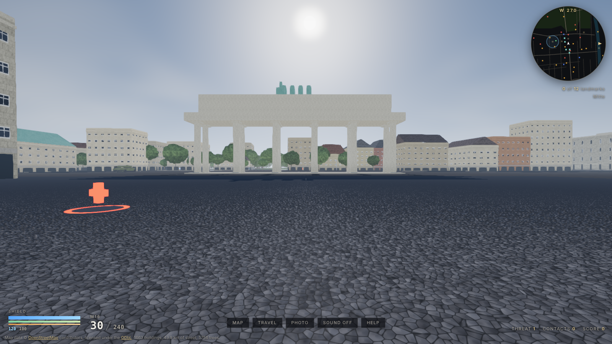
*The spawn, on Pariser Platz looking west at the Gate.*

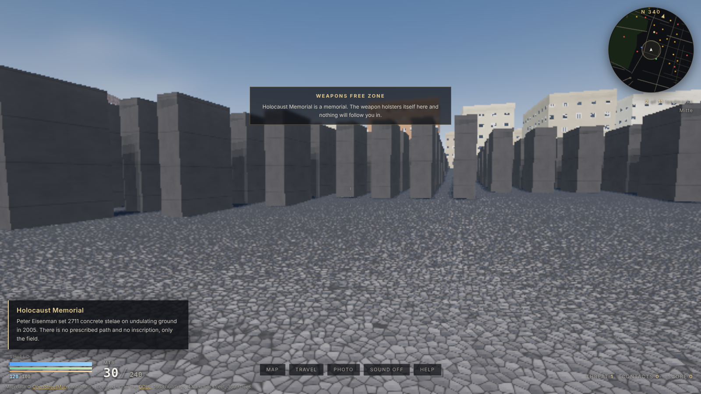
*Inside the field of 2711 stelae, on the undulating floor.*

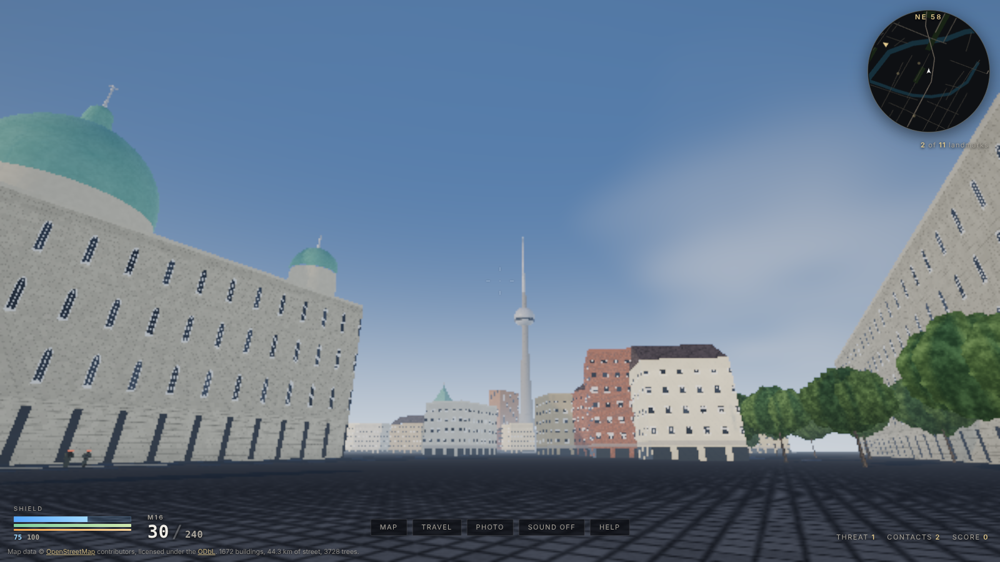
*The Fernsehturm over the roofs, with the Cathedral dome on the left.*

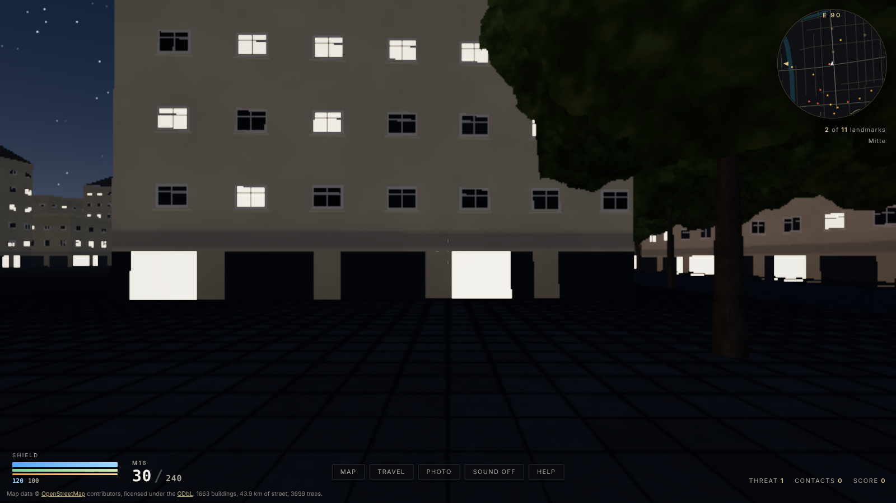
*Unter den Linden after dark, with the windows lit.*

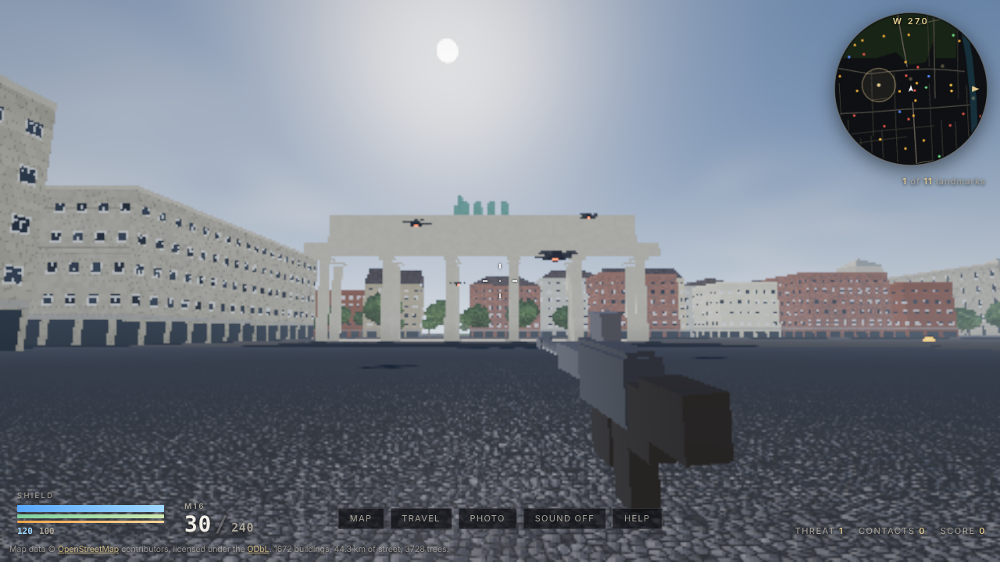
*Four drones over Pariser Platz, with the Gate behind them.*

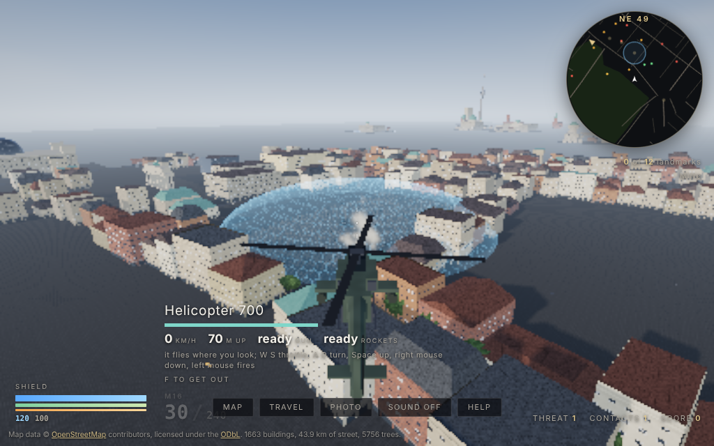
*Inside the memorial the weapon is holstered and the screen says why.*

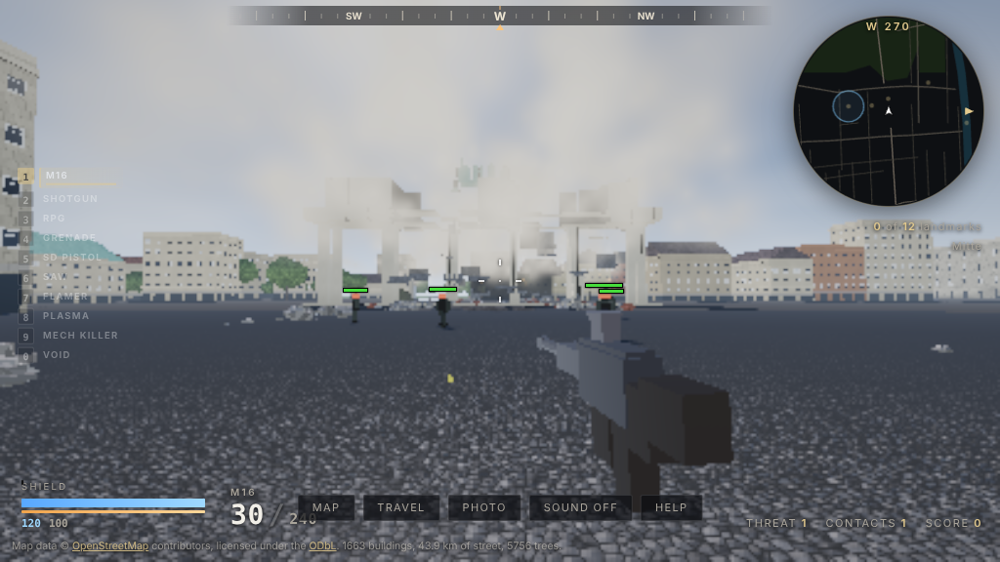
*Soldiers working across Pariser Platz, with a banana on the cobbles.*

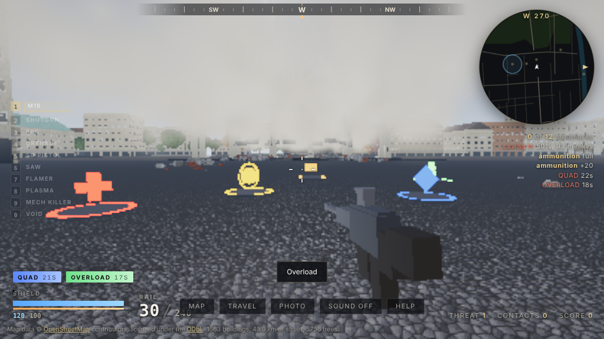
*All five pads on the square: ammunition, a medical kit, quad damage,
ultrashield and overload, with two of them running on the chips bottom left.*

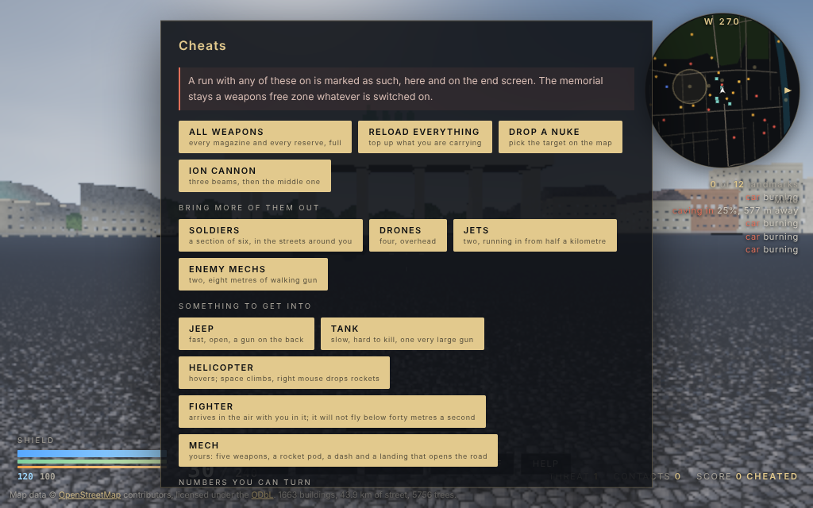
*The cheat menu, with the run already marked bottom right.*

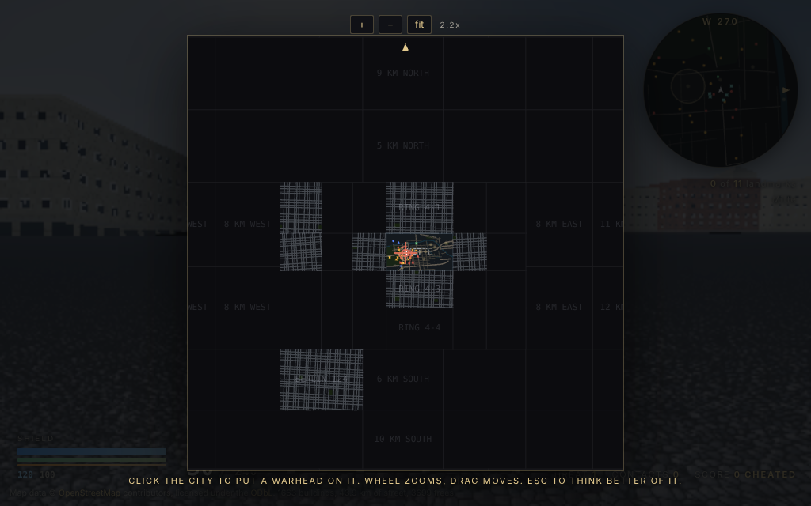
*Picking a target. The gold circle is the memorial, the dashed ring around it
is where the blast may not reach, and the red circle is the blast itself.*

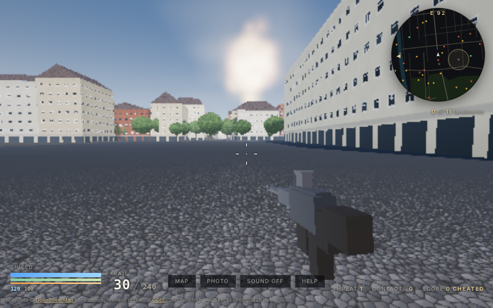
*Half a kilometre east, a few seconds after.*

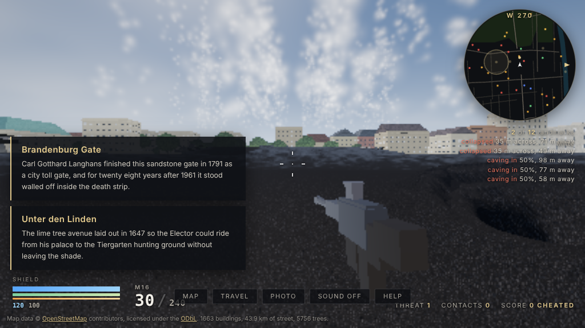
*Two rounds into the Gate. The colonnade has gone and the quadriga is on the
cobbles, the blocks either side have lost their upper storeys, and the rest of
the square is untouched.*

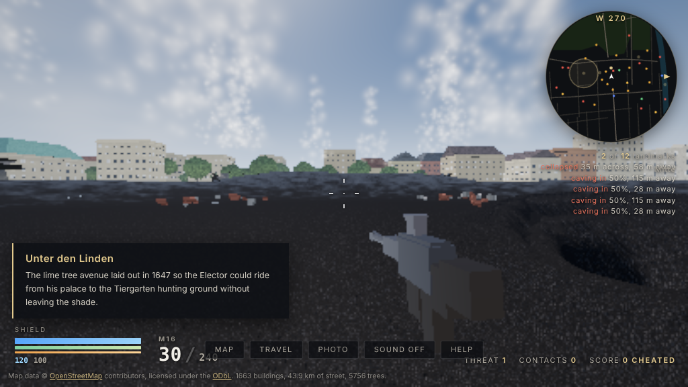
*Three more rounds into the same place.*

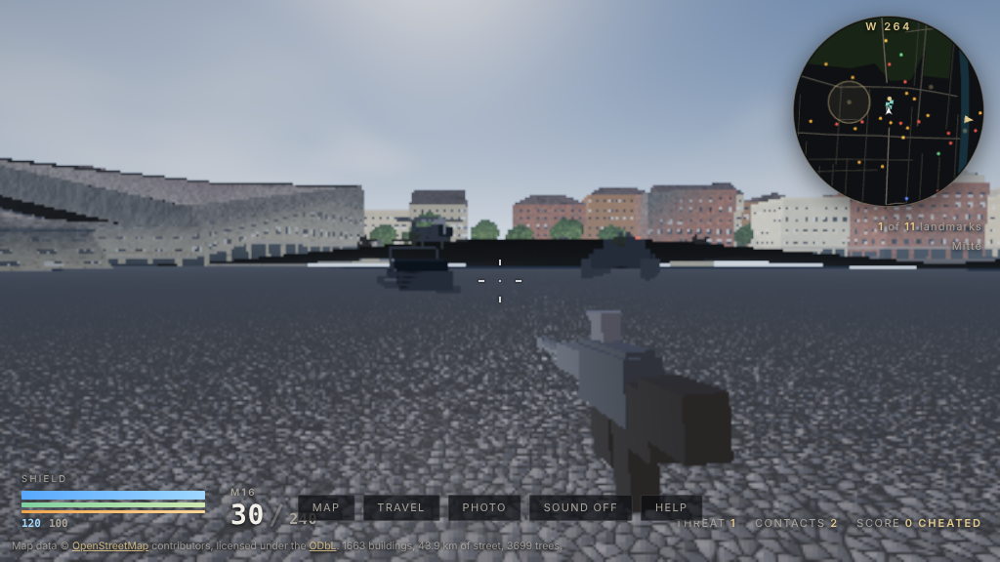
*A jeep, a tank, a helicopter and a fighter, parked on the square.*

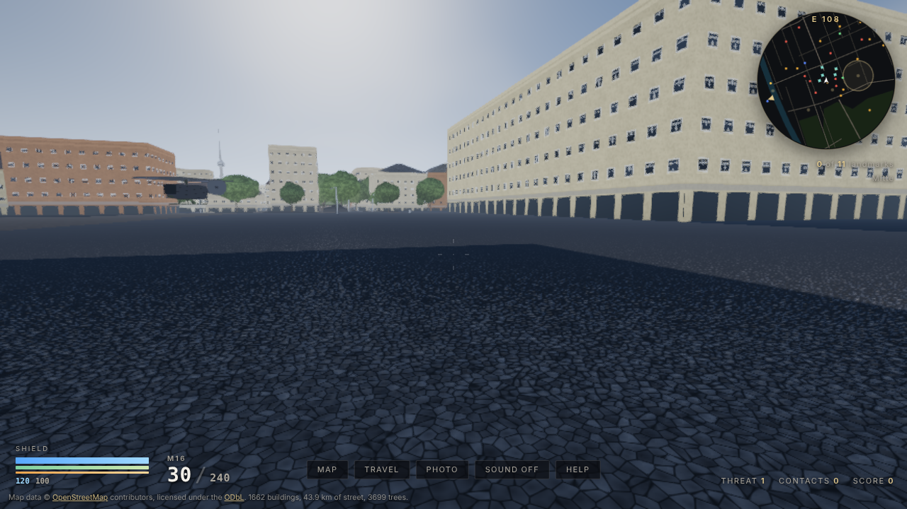
*Sett at eight in the morning. Every stone has its own slope, out of a map
built when the page loaded, and the grain carries into the middle distance
instead of going smooth at thirty metres.*

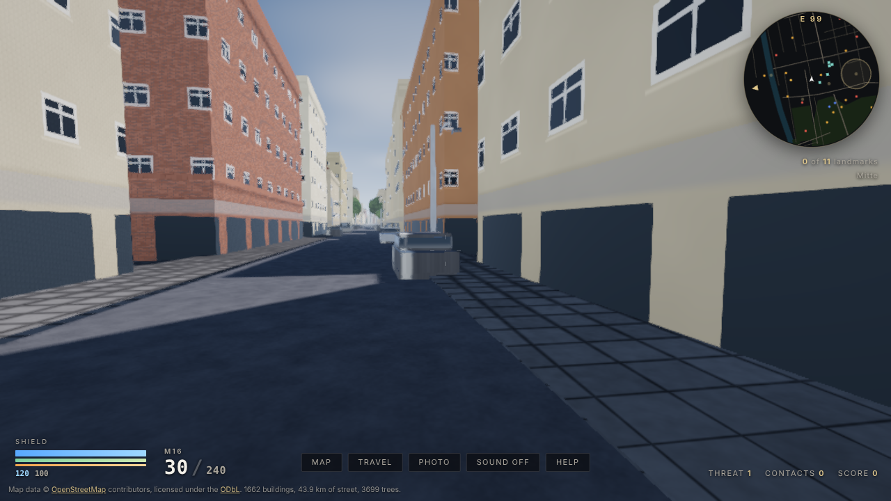
*A side street in Mitte: cars at the kerb and a lamp post standing beside
them.*

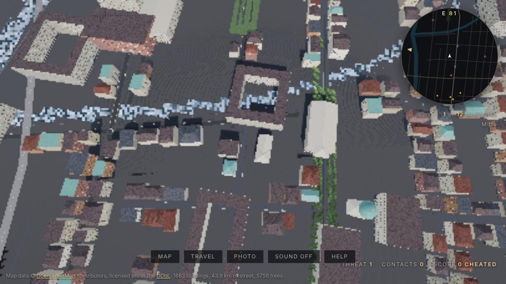
*Free travel, halfway across: three hundred metres up over the roofs of Mitte,
with Unter den Linden running through it.*

The rest are in [docs/screenshots](docs/screenshots), and
[docs/media/gate-to-tower.webm](docs/media/gate-to-tower.webm) is the eleven
second walk from the Gate down Unter den Linden to the foot of the Fernsehturm.
`npm run clip` records it, straight from the page.

## Deploying

The live site is at <https://bjoern-sellnau.github.io/ld-spreefall/>.

The Pages source is **GitHub Actions**, so `.github/workflows/pages.yml` is what
publishes it. On every push it runs the unit tests, fetches a live OpenStreetMap
extract from the Overpass API, builds the world bundle and `dist/`, and deploys
that. The runners can reach Overpass, so **the deployed city is real map data**,
not the offline fallback described above. The Overpass fetch takes three to five
minutes, which is most of the run. The `Record which source was used` step prints
which dataset the build actually got, so a silent fallback cannot go unnoticed.

The other way to publish this repository is **Deploy from a branch**, where
GitHub serves the branch contents as they are and the Actions workflow never
deploys. That path needs the built bundle in the repository rather than
gitignored, which is why `public/world.bin` and `public/world.json` are committed
and there is a `.nojekyll` at the root. They are redundant now that Actions does
the deploying. They are also build output, so as long as they are kept, run
`npm run world` and commit the result after changing anything under `tools/`, or
a branch served site would go on serving the old city.

To host it anywhere else: run `npm run build` and copy `dist/`. There is no
backend, no environment variable, and no build step at the far end.

## Attribution and licence

Map data © [OpenStreetMap](https://www.openstreetmap.org/copyright) contributors,
available under the [Open Database Licence](https://opendatacommons.org/licenses/odbl/).
The attribution is shown in the page footer at all times and is burnt into every
PNG that photo mode saves, because screenshots travel further than the page does.

Any derived database produced from this data must be released under the ODbL. The
geometry in `public/world.bin` is a produced work in ODbL terms: it is generated
from OSM data and is distributed with the attribution above.

The code in this repository is offered under the MIT licence.
